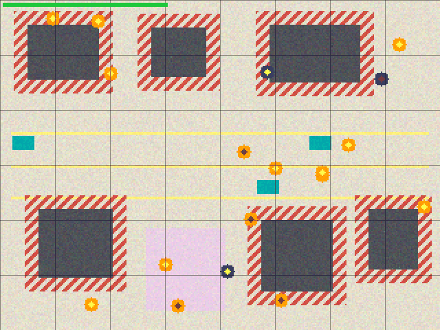
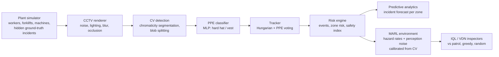
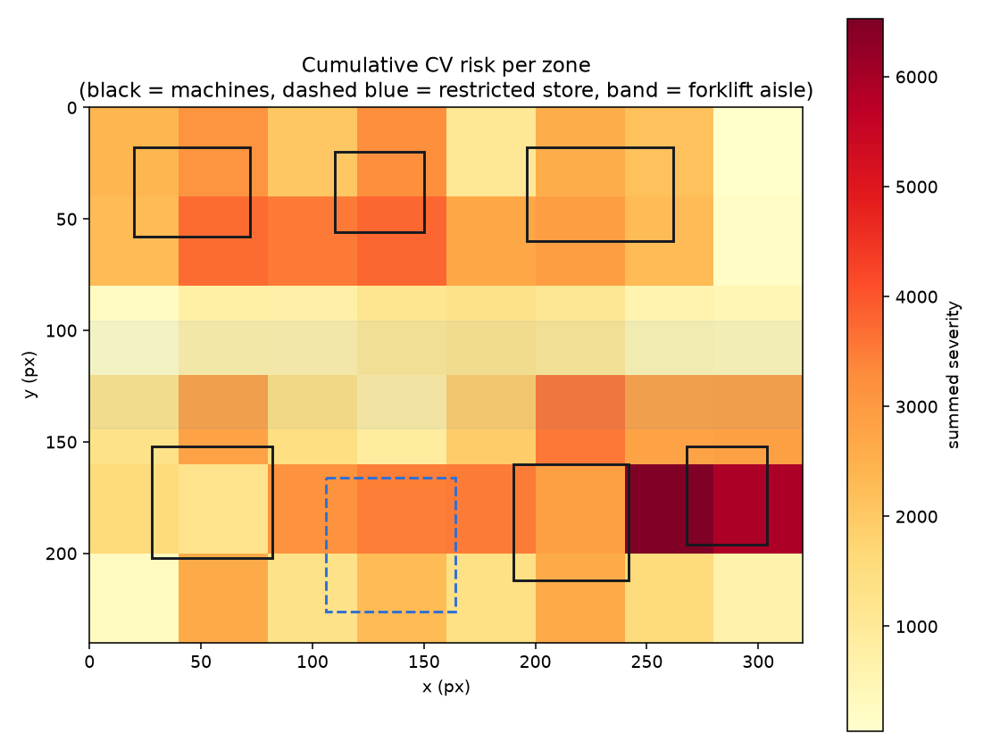
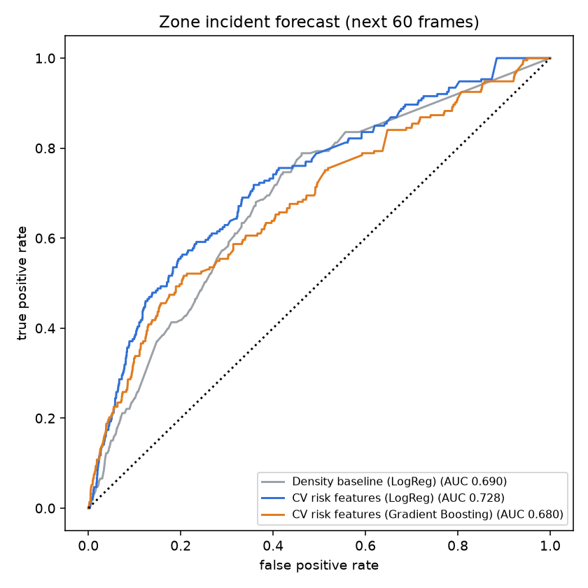
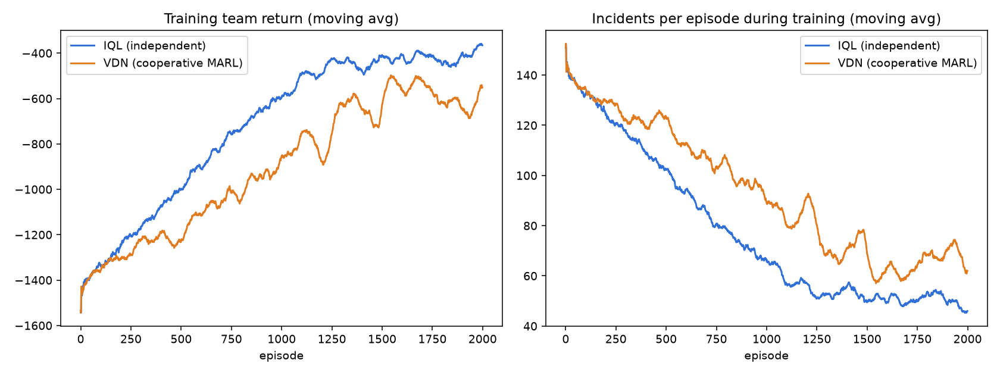
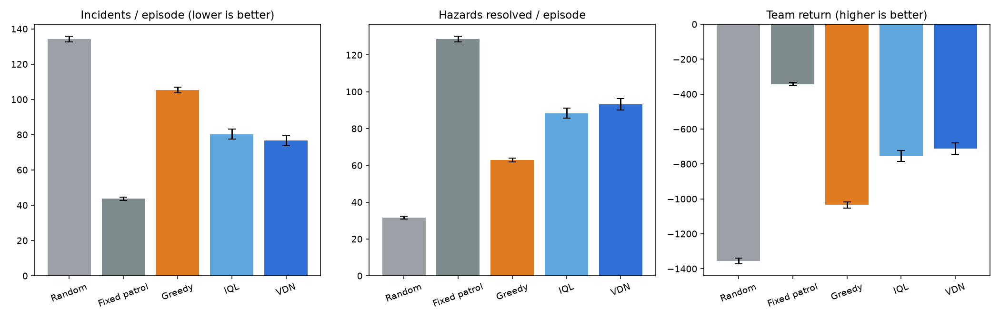

# Safety & Risk Analytics for Manufacturing Plants using Computer Vision with Multi-Agent Reinforcement Learning

**Author:** Bantupalli Srikar Shashank (22IM30035), Department of Industrial and Systems Engineering, IIT Kharagpur
**Course:** Data Analytics project, Semester 9

An end-to-end, fully reproducible pipeline that turns **CCTV frames of a shop floor** into
**safety events, zone risk scores, incident forecasts** and a **multi-agent reinforcement learning (MARL)
policy that decides where safety inspectors should go**.



*Green boxes = workers wearing hard hat and vest, red = PPE violation, cyan = forklift, red tint = live zone risk, bar = plant safety index.*

---

## Architecture



Ground truth from the simulator is used **only** to train and score models. Everything after the renderer
sees camera pixels alone, so the reported metrics reflect a realistic perception pipeline.

| Stage | Module | What it does |
|---|---|---|
| Simulation | `src/safetyvision/simulation/factory.py` | Agent-based plant: 18 workers with individual risk propensity and PPE dynamics, 3 forklifts on an aisle loop, 6 machines with hazard bands, a restricted chemical store, stochastic incidents (struck-by-vehicle, machine contact, hazmat exposure). |
| Camera | `vision/renderer.py` | Top-down 320×240 CCTV frames with sensor noise, illumination change, blur and steam occlusion. |
| Detection | `vision/detector.py` | Illumination-invariant chromaticity, colour-prior masks, morphology, connected components, k-means splitting of merged people. |
| PPE | `vision/ppe_classifier.py` | Head/torso colour descriptors → two MLP heads (hard hat, hi-vis vest). |
| Tracking | `vision/tracker.py` | Hungarian centroid tracker with 5-frame majority vote on PPE state. |
| Real footage | `vision/yolo_adapter.py` | Drop-in adapter for a YOLO PPE model (`ultralytics`) to run the same analytics on real CCTV. |
| Risk | `analytics/risk.py` | Severity per zone (missing PPE, hazard band, restricted area, vehicle near-miss), event log with persistence filter, EMA zone risk, plant safety index. |
| Prediction | `analytics/predictive.py` | Zone × time dataset from CV features → logistic regression and gradient boosting forecasting incidents in the next 60 frames; chronological split, ROC/PR-AUC, lift, permutation importance. |
| MARL | `marl/env.py`, `marl/agents.py`, `marl/train.py` | Inspectors on the 6×8 zone grid. Hazard arrival rates come from the CV risk heat-map; detection recall and false-alarm rate come from the measured CV performance. Learners: Independent Q-Learning (IQL) and Value-Decomposition Networks (VDN), against random, fixed-patrol and greedy baselines. |

## MARL formulation

* **Agents:** 4 safety inspectors; **actions:** inspect current zone, or move N/S/E/W.
* **Hazards:** Poisson arrivals per zone with rate ∝ CV cumulative risk (plus shift-dependent intensity and per-episode noise). An unresolved hazard escalates into an incident with probability `0.01 + 0.004·age` (capped at 0.25).
* **Observation (per agent, from the shared CV hazard map):** own-zone alert level, best and second-best risk directions (distance-weighted look-ahead cones over observed alerts + CV prior), whether a teammate is closer to each target, and whether a teammate is adjacent.
* **Reward:** +1 per hazard resolved, −10 per incident, −0.05 per move, −0.1 per empty inspection. For learning, the sampled incident count is replaced by its conditional expectation (sum of escalation probabilities), which has the same expectation and much lower variance.
* **IQL:** each agent learns from its own reward. **VDN:** `Q_tot = Σ_i Q_i(o_i, a_i)` trained on the team reward. Both use parameter sharing, ε-greedy exploration, learning-rate decay and best-checkpoint selection on separate validation episodes.

## Results

Full numbers, tables and figures: **[results/REPORT.md](results/REPORT.md)** (auto-generated).

### Computer vision (6,000-frame test shift, unseen seed)

| Task | F1 |
|---|---|
| Person detection | **0.986** |
| Forklift detection | **0.960** |
| PPE-violation alert (tracked, missing hard hat or vest) | **0.954** |

PPE classifier accuracy per crop: hard hat 0.991, vest 0.996. Throughput ≈ 26 FPS on a laptop CPU.
The CV risk heat-map correlates with true incident locations (Spearman ρ = 0.66 across 48 zones).

### Incident forecast (incident in a zone within the next 60 frames, positive rate 2.5%)

| Model | ROC-AUC |
|---|---|
| People / forklift density only (logistic regression) | 0.690 |
| **CV risk features (logistic regression)** | **0.728** |
| CV risk features (gradient boosting) | 0.680 |

CV-derived risk features add predictive signal beyond crowd density. Gradient boosting overfits the rare positives under the time-based split.

### MARL inspector dispatch (200 held-out test episodes × 200 steps)

| Policy | Incidents ↓ | Hazards resolved ↑ | Response time (steps) ↓ | Team return ↑ |
|---|---|---|---|---|
| Random | 134.2 | 31.6 | 9.29 | −1355.6 |
| Greedy risk-chasing | 105.3 | 62.9 | 6.20 | −1034.6 |
| IQL (independent) | 80.3 | 88.3 | 5.54 | −754.6 |
| **VDN (cooperative)** | **76.8** | **93.1** | **5.47** | **−711.8** |
| Fixed patrol | 43.7 | 128.6 | 6.51 | −342.7 |

* Both learners clearly beat random and greedy. Cooperative **VDN cuts incidents by 27% versus greedy risk-chasing** and is slightly better than independent learners (IQL), with the fastest response time.
* **The hand-designed fixed patrol is still the best policy.** It keeps inspectors spread over disjoint sectors, which the tabular learners, seeing only local features, do not fully learn. Closing this gap with deep MARL (QMIX / MAPPO) over the full risk map is the main future work.

| Risk heat-map from CV | Incident forecast ROC |
|---|---|
|  |  |
| **MARL learning curves** | **Policy comparison** |
|  |  |

## Quick start

```bash
git clone https://github.com/SRIKAR-SHASHANK/safety-risk-analytics-marl.git
cd safety-risk-analytics-marl
pip install -r requirements.txt
python scripts/run_all.py --quick   # ~1 minute smoke test
python scripts/run_all.py           # full experiment (~20 minutes on a laptop CPU)
pytest -q                           # unit tests
```

All parameters live in `src/safetyvision/config.py`; every run writes its configuration to `results/config.json`.

### Outputs (`results/`)

| File | Content |
|---|---|
| `REPORT.md`, `summary.json` | All metrics |
| `safety_events.csv` | CV-detected safety events (frame, zone, type, track, severity) |
| `ground_truth_incidents.csv` | Simulator incidents (used only for evaluation) |
| `zone_risk_grid.csv` | Cumulative risk per zone |
| `marl_training_log.csv`, `marl_evaluation.csv` | RL training curves and per-episode test results |
| `figures/` | Heat-map, event timeline, safety index, PPE confusion, ROC, feature importance, RL curves, annotated GIF |

## Limitations and future work

* The plant and camera are simulated, so CV accuracy is higher than it would be on real footage; the YOLO adapter is the path to real CCTV (e.g. public construction-site PPE datasets).
* The MARL learners are tabular with hand-crafted observations; deep MARL (QMIX, MAPPO) over the full risk map is the natural next step.
* Pose estimation (ergonomic and fall risk) and a live supervisor dashboard are not yet included.

## Project structure

```
├── scripts/run_all.py            # reproduces every result
├── src/safetyvision/
│   ├── config.py
│   ├── pipeline.py               # CV -> tracking -> risk over a shift
│   ├── simulation/factory.py
│   ├── vision/                   # renderer, detector, PPE classifier, tracker, YOLO adapter
│   ├── analytics/                # risk engine, predictive model
│   ├── marl/                     # environment, agents, training
│   └── reporting/                # plots, frame annotation
├── tests/test_pipeline.py
└── results/                      # generated outputs
```

## License

MIT
