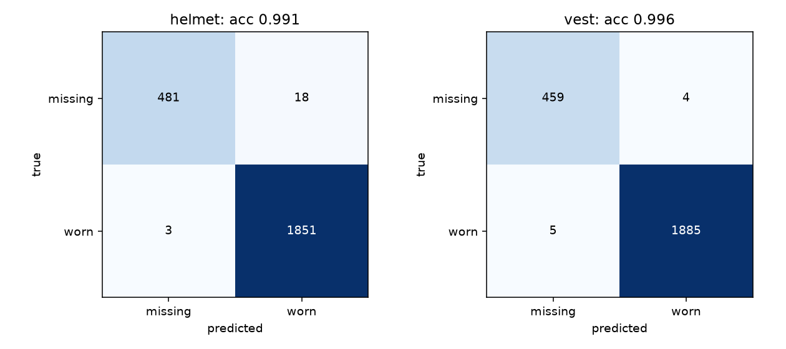
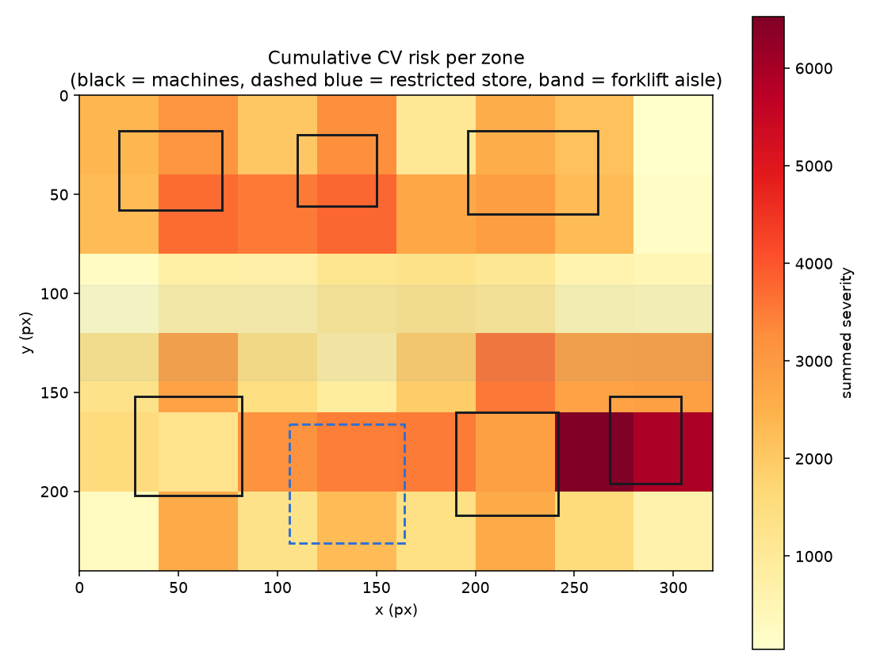
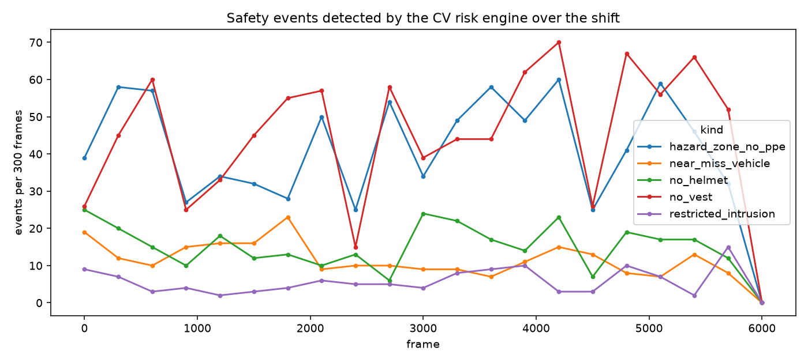
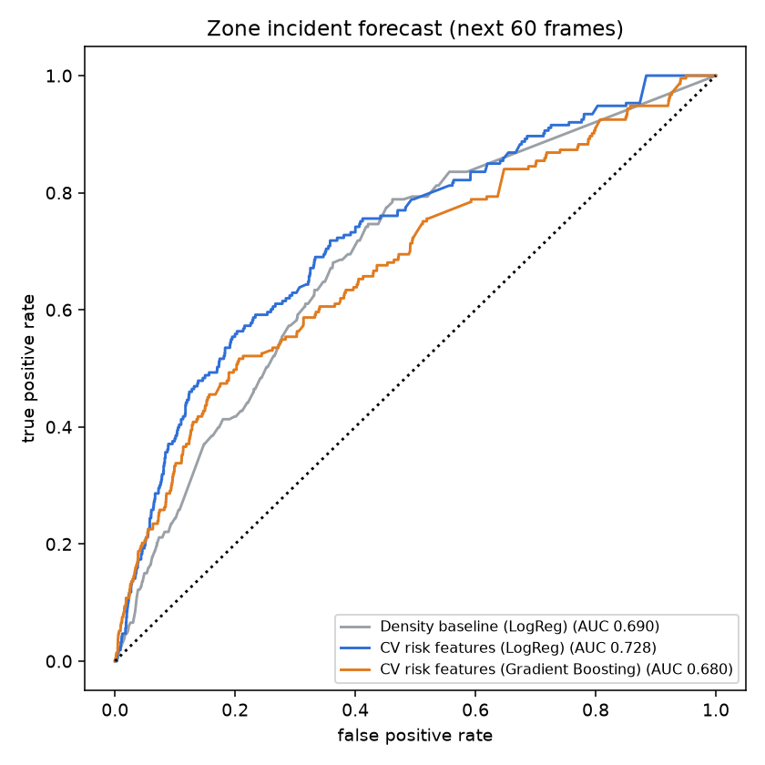
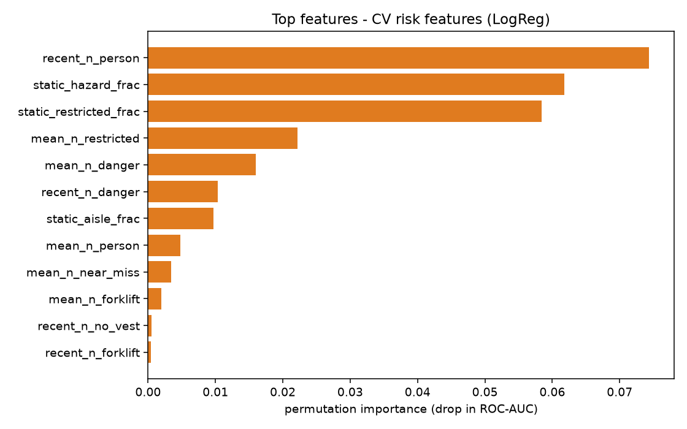
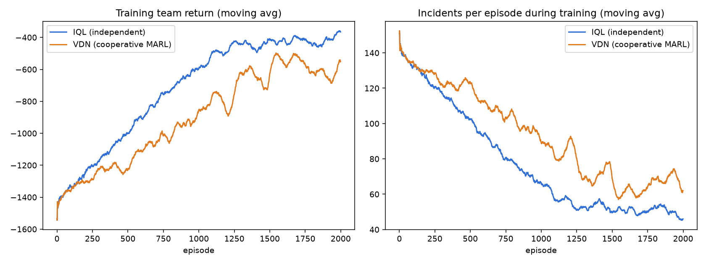
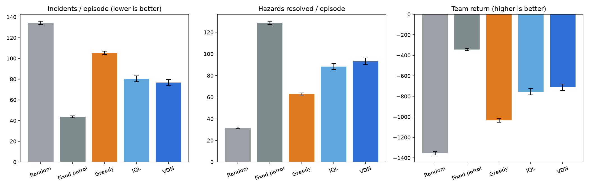

# Results report

_Auto-generated by `scripts/run_all.py`._

## 1. Computer vision

| Task | Precision | Recall | F1 |
|---|---|---|---|
| Person detection | 1.000 | 0.973 | 0.986 |
| Forklift detection | 1.000 | 0.922 | 0.960 |
| PPE-violation alert (tracked) | 0.978 | 0.931 | 0.954 |

PPE classifier (per crop): hard-hat accuracy **0.991**, vest accuracy **0.996** on 2353 held-out crops. Throughput: **26.5 FPS** on CPU.

## 2. Risk analytics

Events detected: no_vest = 945, hazard_zone_no_ppe = 857, no_helmet = 314, near_miss_vehicle = 240, restricted_intrusion = 119.

Ground-truth incidents: machine_contact = 97, struck_by_vehicle = 24, hazmat_exposure = 13.

Spearman correlation between the CV risk heat-map and true incident counts per zone: **0.662**.

## 3. Predictive analytics (incident in zone within next 60 frames)

Train rows 19872, test rows 8496, test positive rate 0.025.

| Model | ROC-AUC | PR-AUC | Brier | Lift @ top 10% |
|---|---|---|---|---|
| Density baseline (LogReg) | 0.690 | 0.049 | 0.0242 | 2.40x |
| CV risk features (LogReg) | 0.728 | 0.068 | 0.0242 | 3.71x |
| CV risk features (Gradient Boosting) | 0.680 | 0.066 | 0.0244 | 3.01x |

## 4. Multi-agent RL inspector dispatch

Mean over held-out test episodes (same seeds for every policy).

| Policy | Incidents | Resolved | Response time | Idle-inspection rate | Team return |
|---|---|---|---|---|---|
| Random | 134.2 | 31.6 | 9.29 | 0.84 | -1355.6 |
| Fixed patrol | 43.7 | 128.6 | 6.51 | 0.02 | -342.7 |
| Greedy (CV risk-chasing) | 105.3 | 62.9 | 6.20 | 0.74 | -1034.6 |
| IQL (independent) | 80.3 | 88.3 | 5.54 | 0.49 | -754.6 |
| VDN (cooperative MARL) | 76.8 | 93.1 | 5.47 | 0.18 | -711.8 |

- IQL (independent) vs Fixed patrol: mean incident difference +36.6, Mann-Whitney p = 9.57e-59
- VDN (cooperative MARL) vs Fixed patrol: mean incident difference +33.1, Mann-Whitney p = 2.28e-61

Total runtime: 17.0 min.